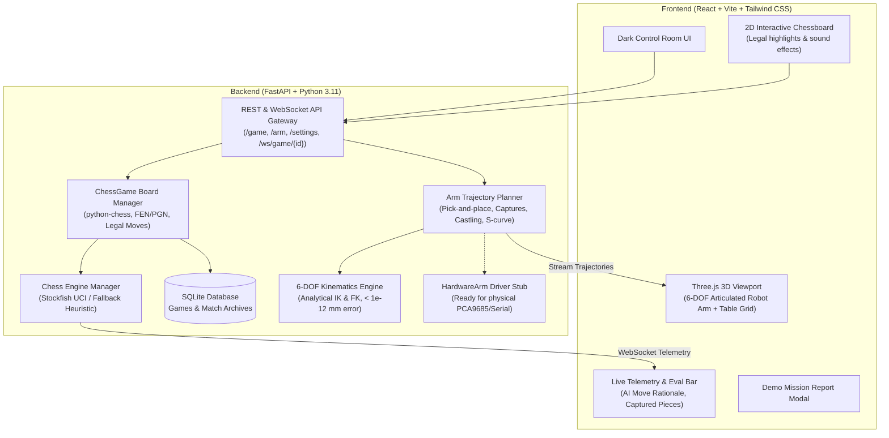

# ChessMate AI: 6-DOF Robotic Chess Control System

> **A software-only autonomous chess platform where a human plays Stockfish on an interactive web interface while a simulated 6-DOF robotic manipulator physically executes the AI's moves in real-time 3D.**

> [!NOTE]
> **Arm is simulated; hardware integration is the planned next phase.**  
> The system includes a complete `HardwareArm` driver stub (`backend/app/arm/hardware.py`) implementing the exact same interface and step decomposition as the simulation, ready for drop-in servo controllers (PCA9685, Arduino, or ROS2).

---

## 🏛️ System Architecture



### Architectural Flow:
1. **Move Validation & AI Engine**: The player moves a piece on the 2D SVG chessboard. The backend validates legality via `python-chess`. Stockfish computes a response with configurable ELO (800–2800), depth, think time, and style (Aggressive, Balanced, Defensive).
2. **Kinematic Decomposition**: The `ArmPlanner` translates the chess move into discrete physical pick-and-place stages:
   - *Normal Moves (9 steps)*: `hover_source` $\to$ `descend_source` $\to$ `grip` $\to$ `lift_source` $\to$ `move_above_target` $\to$ `descend_target` $\to$ `release` $\to$ `retract_hover` $\to$ `retract_home`.
   - *Captures (17 steps)*: Grips and removes the opponent's piece to the side cemetery tray, then grips and places the attacking piece on the destination square.
   - *Special Moves*: Full automated trajectories for King/Rook castling, en passant, and pawn promotion.
3. **Trajectory & 3D Simulation**: Analytical inverse kinematics solves joint angles $(\theta_1 - \theta_6)$ with cubic S-curve polynomial smoothing. Three.js animates the articulated robot arm, end-effector jaws, and coordinate laser in real-time.

---

## 🚀 One-Command Quickstart

### Windows
Double-click `run.bat` or open PowerShell:
```cmd
.\run.bat
```

### Linux / macOS
Make executable and run `run.sh`:
```bash
chmod +x run.sh
./run.sh
```

Then open your browser at **[http://127.0.0.1:8000/app/](http://127.0.0.1:8000/app/)**.

---

## 🛠️ Manual Setup & Installation

### Prerequisites
- **Python 3.11+**
- **Node.js 18+** & npm (for frontend building/development)
- *(Optional)* **Stockfish UCI Engine** (the system automatically falls back to an intelligent built-in heuristic chess engine if Stockfish is not present)

### 1. Stockfish Installation (Optional)
- **Windows**:
  ```powershell
  winget install Stockfish.Stockfish
  ```
  *Or download `stockfish.exe` from [stockfishchess.org](https://stockfishchess.org/download/) and place it in `backend/bin/`.*
- **Ubuntu / Debian**:
  ```bash
  sudo apt-get update && sudo apt-get install -y stockfish
  ```
- **macOS**:
  ```bash
  brew install stockfish
  ```

### 2. Backend Setup
```bash
cd backend
python -m pip install -r requirements.txt
python -m uvicorn app.main:app --host 127.0.0.1 --port 8000 --reload
```

### 3. Frontend Development
```bash
cd frontend
npm install
npm run build   # Compiles to backend/dist for unified serving
# OR run live dev server:
npm run dev     # Starts Vite dev server at http://localhost:5173
```

---

## 🎮 Autonomous Demo Mode

ChessMate AI features a self-playing autonomous demonstration mode:

### In the Web Interface:
1. Navigate to **http://127.0.0.1:8000/app/**.
2. Click the glowing **`▶ RUN DEMO`** button on the top navigation bar or the controls strip.
3. White (Aggressive AI) and Black (Defensive AI) will autonomously play a full game while the 3D robotic arm executes every move.
4. When finished (or when stopped), a **Mission Report** modal displays total moves, elapsed time, final score, and downloadable PGN match archive.

### In the Terminal:
Run the standalone CLI demonstration script:
```bash
python demo.py 6
```
*(Executes 6 moves, outputting analytical IK steps, move rationale, and a mission summary).*

---

## 🤖 Hardware Integration Stub

`backend/app/arm/hardware.py` defines the `HardwareArm` driver stub:
- Implements the exact same interface as `ArmPlanner`: `plan_move()`, `execute_plan()`, `send_joint_angles()`, `set_gripper()`, `emergency_stop()`, and `get_telemetry()`.
- Validates mechanical joint limits $[\text{min\_deg}, \text{max\_deg}]$ for all 6 axes.
- Can be configured for physical serial controllers (`dry_run=False`, `port="COM3"`, `baudrate=115200`).

---

## 🧪 Running Automated Tests

Run the full backend test suite covering illegal move rejection, checkmate/stalemate detection, ELO styling, PGN export, IK accuracy across all 64 squares ($< 10^{-12}\text{ mm}$ error), and hardware driver stubs:

```bash
cd backend
python -m pytest tests -v
```

All 41 tests pass cleanly.

---

## 📡 REST API & WebSocket Reference

| Method | Endpoint | Description |
|---|---|---|
| `POST` | `/game/new` | Create a new match (`human_color`, `elo`, `style`) |
| `POST` | `/game/move` | Execute a human move in UCI notation (e.g. `e2e4`) |
| `POST` | `/game/engine-move` | Request AI engine to compute and make a move |
| `POST` | `/game/pause` | Pause an active game |
| `POST` | `/game/resume` | Resume a paused game |
| `POST` | `/game/resign` | Resign from current game |
| `GET` | `/game/{id}` | Retrieve full details of a specific game |
| `GET` | `/games` | List recent match history with pagination |
| `GET` | `/settings` | Retrieve active engine & system configuration |
| `PUT` | `/settings` | Update ELO, search depth, think time, or play style |
| `POST` | `/arm/plan` | Calculate 6-DOF trajectory waypoints for a move |
| `POST` | `/arm/ik` | Inverse kinematics: Cartesian $[x, y, z] \to [\theta_1..\theta_6]$ |
| `POST` | `/arm/fk` | Forward kinematics: $[\theta_1..\theta_6] \to [x, y, z]$ |
| `WS` | `/ws/game/{id}` | Real-time events: `board_update`, `engine_thinking`, `arm_progress`, `game_over` |

---

## 📄 License
MIT License. Built for autonomous robotic and chess simulation research.
